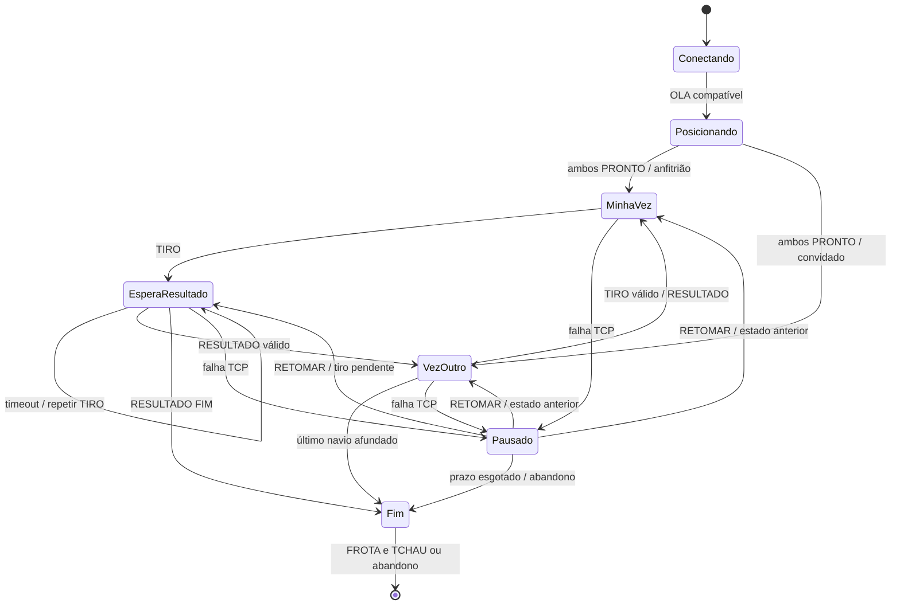
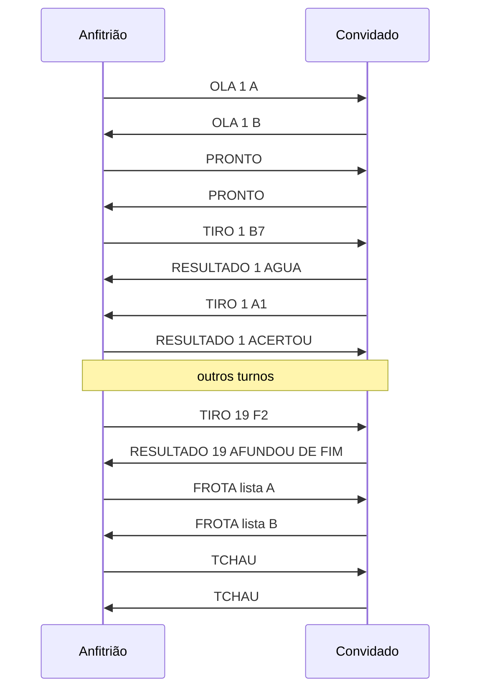

# Protocolo de Batalha Naval P2P — proposta v1

Data: 24/11/2026. Base: enunciado e código recebido. Validar decisões de retomada e temporizadores com a turma antes da entrega.

TCP, UTF-8, uma mensagem por LF (`\n`), campos separados por espaço. O buffer conserva bytes incompletos inclusive após timeout.

| Mensagem | Uso |
|---|---|
| OLA 1 apelido | Ambos enviam ao conectar inicialmente. |
| PRONTO | Ambos enviam após posicionamento. |
| TIRO seq casa | Seq independente por jogador, inicia em 1. |
| RESULTADO seq AGUA / ACERTOU / AFUNDOU codigo [FIM] | Confirma tiro; FIM apenas no último afundamento. |
| ERRO motivo | Mensagem inválida, fora de turno, conflito de sequência etc. |
| RETOMAR enviado recebido | Último TIRO iniciado localmente e último TIRO adversário processado (0 se nenhum). Ambos enviam na nova conexão, sem OLA/PRONTO. |
| FROTA lista | Seis itens codigo:casa:H ou V, somente no fim. |
| TCHAU | Encerramento voluntário ou após conferência. |

## Estados

Timeout de aplicação: 5 s, 3 reenvios com a mesma sequência; depois reconexão. Cache guarda coordenada e resposta antes do envio. Mesmo seq e coordenada repete resposta; seq igual com outra coordenada gera ERRO. O turno não muda em duplicatas. Resultados repetidos idênticos são ignorados. Erros não confirmam tiros. A reconexão dura até aproximadamente 60 s, preserva estado em RAM e repete apenas o tiro sem RESULTADO; o peer usa cache se já o processou. SO_KEEPALIVE habilitado, mas o prazo padrão do sistema pode ser longo durante ociosidade. Não há heartbeat novo para evitar extensão unilateral do protocolo. A troca final é reexecutada se a falha for detectada antes do fechamento. Conferência reproduz os tiros em ordem e compara resultado e FIM; não prova que a frota não mudou (não há compromisso criptográfico).
